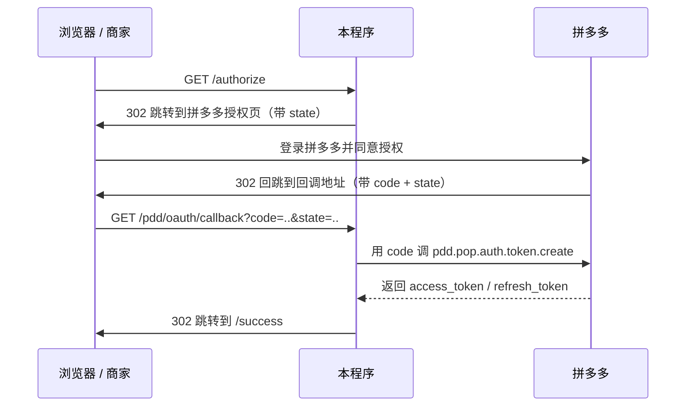

# 使用文档：拼多多开放平台回调测试程序

本文档教你如何配置、启动本程序，完成一次完整的商家授权，并说明每个 HTTP 接口怎么访问。

## 1. 这是什么

一个用 Go 标准库写的最小可运行示例，演示「企业ERP」服务商接入拼多多开放平台的核心闭环：

```text
商家授权 → 回调地址接收 code → 换取 access_token → 调用业务接口（订单查询）
```

程序内置 7 个 HTTP 接口，授权得到的 token 会落到本地的 `data/tokens.json`。

## 2. 目录结构

```text
pdd-callback-test/
├── main.go          # 入口：读配置、启动 HTTP 服务
├── config.go        # 配置结构
├── config.json      # 配置文件（改这里）
├── pdd.go           # 拼多多客户端：签名、换 token、刷新、订单
├── server.go        # HTTP 路由与处理
├── store.go         # token 落库 + state 内存存储
├── server_test.go   # httptest 测试
├── Makefile
├── README.md
├── AGENTS.md         # 协作约定：变更必须同步文档 + commit + push
├── 使用文档.md       # 本文档
└── 小白教程-Token有效期与自动刷新.md   # token 到底多久过期、怎么自动续
```

## 3. 前置准备：在拼多多开放平台创建应用

1. 登录拼多多开放平台，创建「企业ERP」类应用；
2. 创建后拿到 `client_id` 和 `client_secret`（secret 请妥善保管）；
3. 在应用「回调地址 / 授权回调」处填一个回调地址，必须与 `config.json` 里的 `pdd.redirect_uri` 完全一致。

## 4. 配置说明（config.json）

| 字段 | 默认值 | 说明 |
| --- | --- | --- |
| `server.host` | `0.0.0.0` | 监听地址，`0.0.0.0` 表示监听所有网卡 |
| `server.port` | `8080` | 监听端口 |
| `pdd.client_id` | - | 必填，应用 client_id |
| `pdd.client_secret` | - | 必填，应用密钥 |
| `pdd.redirect_uri` | - | 必填，回调地址，必须与控制台一致 |
| `pdd.gateway` | `https://gw-api.pinduoduo.com/api/router` | 网关地址 |
| `pdd.auth_url` | `https://mms.pinduoduo.com/open.html` | 授权页地址 |
| `token_store_file` | `data/tokens.json` | token 落库文件 |
| `log_level` | `info` | 预留字段，暂未参与日志级别过滤 |

示例（本地调试）：

```json
{
  "server": {
    "host": "0.0.0.0",
    "port": 8080
  },
  "pdd": {
    "client_id": "你的 client_id",
    "client_secret": "你的 client_secret",
    "redirect_uri": "http://localhost:8080/pdd/oauth/callback",
    "gateway": "https://gw-api.pinduoduo.com/api/router",
    "auth_url": "https://mms.pinduoduo.com/open.html"
  },
  "token_store_file": "data/tokens.json",
  "log_level": "info"
}
```

注意：回调地址的路径部分（`/pdd/oauth/callback`）同时决定了程序回调接口的路由。如果改成 `https://erp.example.com/auth/pdd/callback`，程序会自动把回调处理挂到 `/auth/pdd/callback`。

## 5. 启动运行

方式一：make

```bash
make run
```

方式二：go run

```bash
go run . -config config.json
```

方式三：编译后运行

```bash
make build
./bin/pdd-callback-test -config config.json
```

Windows 下没有 make 时：

```powershell
go build -o bin\pdd-callback-test.exe .
bin\pdd-callback-test.exe -config config.json
```

启动成功会打印：

```text
监听地址: http://0.0.0.0:8080
授权入口: http://0.0.0.0:8080/authorize
回调地址: http://localhost:8080/pdd/oauth/callback（请与控制台配置保持一致）
```

## 6. 授权流程



具体步骤：

1. 启动程序后，浏览器打开 `http://localhost:8080`（首页）；
2. 点「点击开始商家授权」，浏览器跳转到 `/authorize`；
3. 程序生成一个一次性 `state`（10 分钟有效）并 302 跳转到拼多多授权页；
4. 商家登录拼多多并同意授权；
5. 拼多多把浏览器 302 回跳到回调地址，例如：
   `http://localhost:8080/pdd/oauth/callback?code=xxxx&state=yyyy`；
6. 程序校验 `state`，再用 `code` 调 `pdd.pop.auth.token.create` 换取 token，写入 `data/tokens.json`；
7. 程序 302 跳转到 `/success`，显示授权结果和「查询订单」链接；
8. 之后即可调用 `/orders` 等业务接口。

## 7. 接口清单

| 方法 | 路径 | 作用 |
| --- | --- | --- |
| GET | `/` | 首页 |
| GET | `/authorize` | 发起授权（跳拼多多授权页） |
| GET | `/pdd/oauth/callback` | 授权回调（路径随 `redirect_uri` 变化） |
| GET | `/success` | 授权成功页 |
| GET | `/orders` | 查询订单 |
| GET | `/tokens` | 查看已授权商家 |
| GET | `/healthz` | 健康检查 |

### 7.1 GET /authorize

发起授权。无参数，浏览器访问即可：

```text
http://localhost:8080/authorize
```

程序会生成 `state` 并 302 跳转到拼多多授权页。不要用 curl 直接访问（它是跳转入口）。

### 7.2 GET /pdd/oauth/callback

授权回调接口，由拼多多在商家授权后自动回跳，不需要手动访问。

- 查询参数：`code`（必填，授权码）、`state`（必填，防 CSRF）；
- 行为：校验 state → 用 code 换 token → 落库 → 302 跳转 `/success`；
- 该路径由 `config.json` 的 `pdd.redirect_uri` 的路径部分决定。

### 7.3 GET /success

授权成功页。参数由回调自动携带：

- `owner_id`：商家 ID；
- `owner_name`：商家名称。

页面里提供「查询该商家订单」的链接。

### 7.4 GET /orders

用已授权 token 查询订单，演示「回调成功后调用拼多多业务接口」。

查询参数：

| 参数 | 必填 | 默认值 | 说明 |
| --- | --- | --- | --- |
| `owner_id` | 是 | - | 商家 ID，来自授权结果 |
| `page` | 否 | 1 | 页码 |
| `page_size` | 否 | 20 | 每页条数 |

返回示例：

```json
{
  "owner_id": "123456",
  "total": 100,
  "page": 1,
  "orders": [
    {
      "order_sn": "240101-0000",
      "order_status": 1,
      "goods_amount": 9900,
      "receiver_name": "张三",
      "receiver_phone": "13800000000"
    }
  ]
}
```

curl 示例：

```bash
curl "http://localhost:8080/orders?owner_id=123456&page=1&page_size=20"
```

说明：token 在 5 分钟内到期时，程序会自动用 `refresh_token` 刷新后再查询；订单字段以拼多多官方返回为准。

> **token 到底能有多久、会不会过期、能不能永久？** 见 [小白教程-Token有效期与自动刷新.md](./小白教程-Token有效期与自动刷新.md)。结论：企业ERP 类应用是 **24 小时**，最长有效期只有「二方系统已上线」的 1 年，**不存在永久 token**。

### 7.5 GET /tokens

查看已授权商家列表（token 打码显示，不会泄露完整 token）。

```bash
curl http://localhost:8080/tokens
```

返回示例：

```json
{
  "count": 1,
  "tokens": [
    {
      "owner_id": "123456",
      "owner_name": "某某旗舰店",
      "access_token_masked": "abcd****wxyz",
      "expires_at": 1700000000
    }
  ]
}
```

### 7.6 GET /healthz

健康检查。

```bash
curl http://localhost:8080/healthz
```

返回：

```json
{"status":"ok"}
```

## 8. 本地调试 vs 公网授权

- **本地调试**：`redirect_uri` 填 `http://localhost:8080/pdd/oauth/callback`，只能自测流程；拼多多真实回调是否允许 localhost，以官方文档为准。
- **真实公网授权**：需要把回调地址暴露成公网 HTTPS。可以用反向代理或内网穿透（ngrok、frp、花生壳等）把 `https://erp.example.com/...` 转发到本地 `8080`，同时把 `config.json` 的 `pdd.redirect_uri` 和拼多多控制台的回调地址都填成同一个 HTTPS 地址。

## 9. 数据存储

授权成功后，token 写入 `config.json` 中 `token_store_file` 指向的文件，例如 `data/tokens.json`：

```json
{
  "123456": {
    "owner_id": "123456",
    "owner_name": "某某旗舰店",
    "access_token": "明文 token",
    "refresh_token": "明文 token",
    "scope": [],
    "expires_in": 86400,
    "fetched_at": 1700000000
  }
}
```

> 注意：为方便本地测试，token 以明文 JSON 落库。生产环境请改为加密存储（如 AES 加密 + 数据库），并接入 Redis/Session 管理 `state`。

## 10. 常见问题排查

- **回调返回 400「state 校验失败」**：可能重复刷新了授权页、state 已过期（10 分钟）、或授权链接被复制后二次使用。从 `/authorize` 重新发起即可。
- **提示「缺少授权码 code」**：拼多多没有带回 code，通常是没有真正完成授权，或回调地址与控制台不一致。
- **code 过期或已使用**：code 一次性且短时效，换 token 失败后重新发起授权。
- **授权页报错 / 无法跳回**：检查 `pdd.redirect_uri` 与拼多多控制台配置是否完全一致（协议、域名、路径都算）。
- **端口被占用**：修改 `server.port` 后重启。
- **订单查询返回 token 相关错误**：`/orders` 会自动刷新，若 refresh_token 也失效，需重新授权。

## 11. 安全注意

- `client_secret`、`access_token`、`refresh_token` 不要提交到公开仓库；
- token 必须加密存储、按商家（owner_id）隔离，禁止明文写日志；
- 生产环境回调地址务必使用 HTTPS；
- `state` 防 CSRF 已内置，请勿改成固定值；
- 接口名、参数、签名算法以拼多多官方文档为准。
